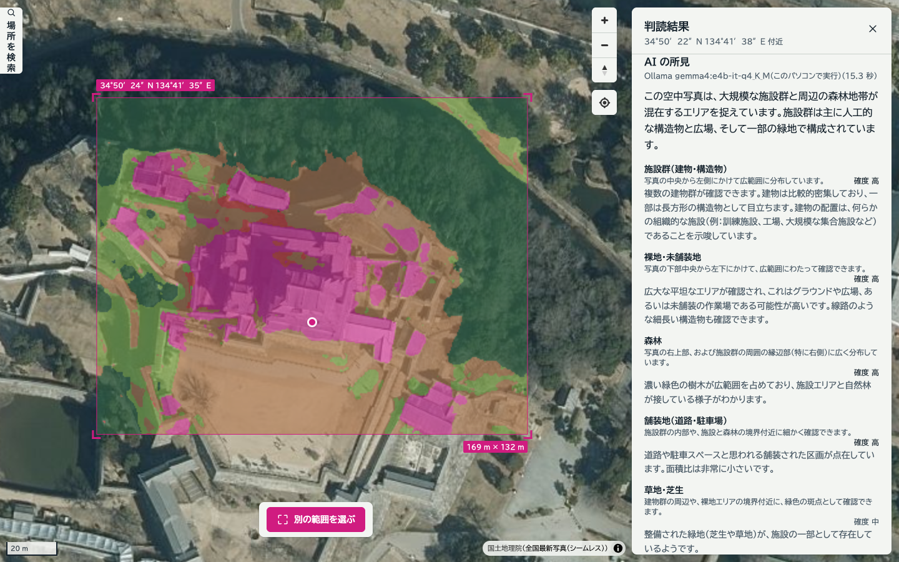
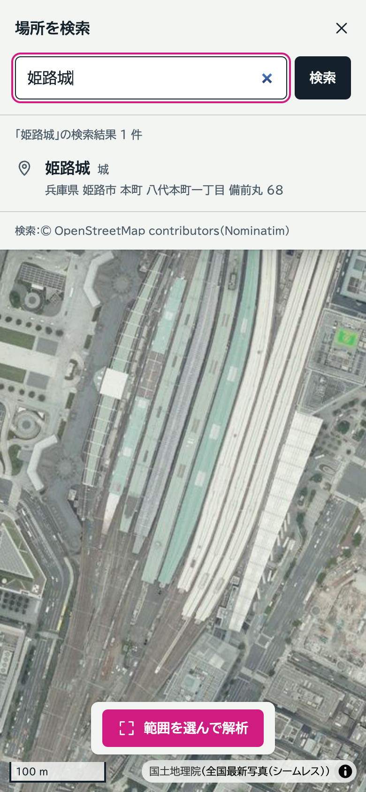
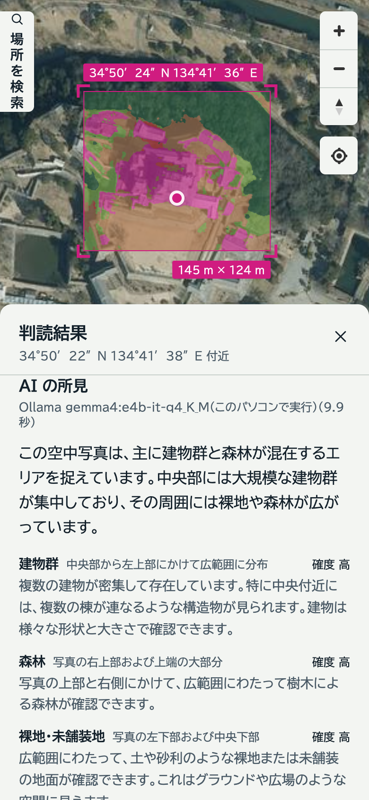
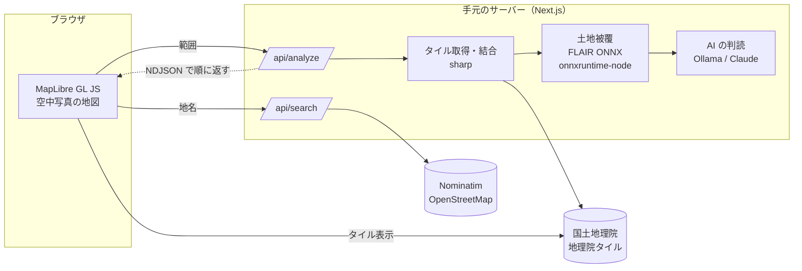

# sat_ai_vision

地図で範囲を選ぶと、その範囲の空中写真を手元のサーバーで解析し、写っているものを AI が日本語で説明する Web アプリです。
個人の検証・ポートフォリオ用です。



<sub>空中写真：国土地理院「全国最新写真（シームレス）」を加工して作成</sub>

## できること

- **開くとすぐ地図**：背景は国土地理院の空中写真です。
- **場所の検索**：左端のタブから、地名やランドマーク（例：姫路城、清水寺、札幌駅）を検索できます。
  結果を選ぶと地図がそこへ移り、URL（`#map=ズーム/緯度/経度`）がそのままその場所へのリンクになります。
- **地図の操作**：右上に拡大・縮小、コンパス（回転を北に戻す）、現在地。
- **範囲を選んで解析**：地図をドラッグ（スマホは指でなぞる）して範囲を選ぶと、次の順に結果が出ます。
  1. 空中写真の取得：範囲を覆うタイルを最も細かいズームで取り、1 枚に結合（約 0.49 m/px）
  2. 土地被覆の判定：建物・舗装地・裸地・水域・森林・草地・農地の 7 区分の構成比と面積。地図にも重ねて表示
  3. AI の判読：写真から読み取れる地物（駅のホーム、水田、工場、港湾施設など）を、写真の中の位置と確度つきで説明

スマホ・タブレット・PC のどれでも、ボタンやパネルが重ならないように作っています。

| スマホ：検索 | スマホ：判読結果 |
|---|---|
|  |  |

## しくみ



- 解析の進み具合と結果は NDJSON（1 行 1 イベント）で返し、画面は届いたものから表示します。
- 取得したタイルと解析結果は `.cache/` に残し、同じ範囲を何度も取りに行きません。

### 画像の選び方：なぜ国土地理院か

「なるべく解像度の高い画像」を条件に、主な提供元の利用規約を一次資料で確認しました（2026-10）。

| 提供元 | 日本の解像度 | サーバーでの取得・結合 | AI での画像解析 |
|---|---|---|---|
| Google Map Tiles API | 最も高い（都市部は航空写真） | 禁止 | 禁止（"Image analysis" "Object detection" を明記） |
| Esri World Imagery | 約 0.3 m | 禁止 | 禁止 |
| Mapbox Satellite | 約 0.5 m | 禁止 | 禁止（機械学習の "operate" を含む） |
| MapTiler Satellite | 約 0.5 m | 禁止 | 禁止（データの抽出・派生） |
| **国土地理院 全国最新写真（シームレス）** | **約 0.5 m（z18）** | **可（出典の明示）** | **可（公共データ利用規約 PDL1.0）** |

商用の高解像度画像は、どれも「地図に表示すること」にしか使えません。範囲を切り出して AI にかけるこのアプリの使い方が規約上できるのは、
国土地理院の写真だけでした。そのため画像は日本国内に限られ、衛星画像ではなく航空写真が中心です。

地理院タイルは同じ URL でもズームによって中身が変わり（z2〜8 世界衛星モザイク、z9〜13 Landsat 8、z14〜18 空中写真）、
それぞれに出典の示し方が決まっています。地図ではズーム帯ごとにソースを分け、いま見えている画像の出典だけを出しています。

### 土地被覆の判定

IGN（フランス国土地理院）の [FLAIR-INC](https://huggingface.co/IGNF/FLAIR-INC_rgb_15cl_resnet34-unet)（RGB・15 クラス、ResNet34-UNet）を ONNX に変換し、
`onnxruntime-node` で推論します（Mac は CoreML を使い、2,000 px 四方で数秒）。

フランスの航空写真（0.2 m/px）で学習したモデルなので、日本の地理院写真 6 地点（都心・水田・山林・港湾・公園・住宅地）で実測して使い方を決めました。

| 推論する解像度 | 結果 |
|---|---|
| 等倍（約 0.49 m/px） | 都心のビル・水田は良いが、**港の水面が消え（1%）、戸建住宅が道路に埋もれる（建物 16%）** |
| **1.5 倍（約 0.33 m/px）** | **住宅は建物 40% に戻り、都心も崩れない。採用** |
| 2 倍（約 0.24 m/px） | 水面は最も出るが、都心のビルに農地・温室の誤判定が散る |

15 クラスは日本で当てにならない区別（針葉樹と広葉樹、温室・ぶどう畑・プールなど）があるため、
確率を足し合わせて 7 区分にまとめて表示します。波のある海面は今でも裸地・舗装地と判定されることがあり、画面にもその旨を出しています。

モデルが無い環境でも動くよう、写真の色（緑の強さ・明るさ・彩度）だけで分ける簡易推定に自動で切り替わります。

### AI の判読

写真と、土地被覆の数値・写真の条件（中心の緯度経度、範囲、北が上）を VLM（画像を読める言語モデル）に渡し、
「全体の要約・地物ごとの所見（写真の中の位置と確度つき）・判断できないこと」を JSON で返させます。
VLM は面積比や個数の推定が苦手なので、割合は土地被覆の数値を正とし、VLM には何が写っているかの言語化だけを任せています。

既定は手元の [Ollama](https://ollama.com/) で動く **Gemma 4 E4B**（`gemma4:e4b-it-q4_K_M`）です。写真は外へ出ず、費用も掛かりません。
`ANTHROPIC_API_KEY` を設定すると Claude で判読します（所見は詳しくなりますが、写真が Anthropic に送られ、利用料が掛かります）。

モデルは、土地被覆と同じ 6 地点で、手元で動く 3 つを比べて決めました（Apple M シリーズ、写真の長辺 1,536 px）。
判読結果はどのモデルのものかを伏せて、画像と見比べて「正確さ・捏造」「位置（左上・中央など）」「日本語と数値の扱い」を 5 段階で採点しています。

| モデル | 1 枚の時間 | 正確さ | 位置 | 日本語 | 結果 |
|---|---|---|---|---|---|
| **Gemma 4 E4B（Q4_K_M、思考なし）** | **13〜46 秒** | **3.5** | **4.2** | **3.0** | **採用。所見が具体的で、捏造が最も少ない** |
| Gemma 4 E4B（nvfp4、思考なし） | 15〜20 秒 | 2.8 | 3.7 | 2.7 | Mac では MLX で動き、構造化出力（JSON の型の指定）が使えない |
| Qwen3-VL 8B Instruct | 32〜62 秒 | 3.0 | 4.2 | 2.0 | 写真に無い施設名を作る、です・ます調にならない |
| Qwen3-VL 8B（思考あり） | 236〜316 秒 | − | − | − | 遅すぎるため対象外 |

Gemma 4 は考えさせる（thinking）と 1 枚に 20 秒〜十数分かかり、時間が読めません。
採用した版は考えさせなくても、考えさせた nvfp4 版と同じ程度の点（平均 3.6）だったため、考えさせずに使います。
土地被覆の数値を渡さない場合とも比べました。数値の繰り返しが無くなるぶん日本語の点は上がります（3.0 → 3.5）が、
1 地点あたりの誤りが増えた（1.8 → 3.0 件）ため、数値は渡しています。

どのモデルでも、見落としや、似た地物の取り違え（収穫後の水田を畑と読むなど）は残ります。所見は目安としてお読みください。

## 動かし方

必要なもの：Node.js 20.12 以上、macOS または Linux。AI の所見を出すには [Ollama](https://ollama.com/)（または Anthropic の API キー）。

```bash
git clone https://github.com/habe1111/sat-ai-vision.git
cd sat-ai-vision
npm install
npm run setup        # 土地被覆モデル（約 98 MB）の取得と、Ollama の確認
npm run dev          # http://localhost:3000
```

AI の所見を手元で出すには、Ollama を入れて起動し、モデルを取得します。

```bash
brew install ollama                 # Mac。Linux は https://ollama.com/download の手順で
ollama serve                        # 起動（別のターミナルで開いたままにする）
ollama pull gemma4:e4b-it-q4_K_M    # 判読に使うモデル（約 6.6 GB）
npm run setup                       # Ollama とモデルが見えるかを確認
```

初回の判読はモデルの読み込みに 10 秒ほど余計に掛かります。メモリは 8 GB 以上の空きがあると安定します。

### 設定（任意）

`.env.example` を `.env.local` にコピーして書き換えます。

| 変数 | 既定値 | 内容 |
|---|---|---|
| `AI_PROVIDER` | `auto` | `auto`（キーがあれば Claude、無ければ Ollama）/ `ollama` / `anthropic` / `none` |
| `OLLAMA_HOST` | `http://127.0.0.1:11434` | Ollama の場所 |
| `OLLAMA_MODEL` | `gemma4:e4b-it-q4_K_M` | 判読に使うモデル。構造化出力（`format`）に対応したものを選ぶ |
| `ANTHROPIC_API_KEY` | （なし） | 設定すると Claude で判読します。写真が Anthropic に送られ、利用料が掛かります |
| `ANTHROPIC_MODEL` | `claude-opus-5-5` | Claude のモデル |

### 動作確認

```bash
npm run lint && npm run typecheck
npm run dev &                                  # 別のターミナルでも可
BASE_URL=http://localhost:3000 npm run e2e     # PC の画面
BASE_URL=http://localhost:3000 VIEWPORT=mobile npm run e2e   # スマホの画面（指でなぞって範囲を選ぶ）
BASE_URL=http://localhost:3000 VIEWPORT=landscape npm run e2e  # スマホの横向き
```

E2E は headless Chrome で「地図が出る → 検索して結果を選ぶと URL が移動先を指す → 範囲を選ぶ → 土地被覆と AI の所見が出る」までを確かめ、
各段のスクリーンショットを `e2e-out/` に残します。Chrome の場所は `CHROME_PATH` で変えられます。
AI が使えないときは「所見を出せない理由」が出れば通ります。`REQUIRE_AI=1` を付けると、所見が出なければ失敗にします。

## 制約

- 空中写真は**日本国内だけ**です。範囲は一辺およそ 60 m〜8 km（解析する画像の長辺は 4,096 px まで）。
- 写真は撮影時期が場所によって違い、隣り合う地域で季節が変わることがあります（シームレス写真の継ぎ目）。
- 土地被覆の数値は、海外で学習したモデルの判定です。目安としてお読みください。
- AI の所見は写真から読み取れることに限っています。施設名などの固有名詞は、写真に文字が読めるとき以外は書かせていません。

## 出典・ライセンス

- 空中写真：[国土地理院](https://maps.gsi.go.jp/development/ichiran.html)「全国最新写真（シームレス）」ほか（地理院タイル）。解析結果の画像はこれを加工して作成しています。
- 検索：© [OpenStreetMap](https://www.openstreetmap.org/copyright) contributors（[Nominatim](https://nominatim.org/)。[利用ポリシー](https://operations.osmfoundation.org/policies/nominatim/)に従い、毎秒 1 件まで・確定時のみ検索）
- 土地被覆モデル：IGN [FLAIR-INC](https://huggingface.co/IGNF/FLAIR-INC_rgb_15cl_resnet34-unet)（2024-08-09 更新、[Etalab 2.0](https://www.etalab.gouv.fr/licence-ouverte-open-licence/)）を ONNX に変換して使用。変換手順は [tools/flair-export](tools/flair-export/)
- 判読モデル（既定）：Google [Gemma 4](https://ollama.com/library/gemma4) E4B（[Apache License 2.0](https://www.apache.org/licenses/LICENSE-2.0)）。このリポジトリには含めず、各自が Ollama で取得します
- このリポジトリのコード：[MIT License](LICENSE)

## メンテナンス

土地被覆モデルは GitHub Releases（タグ `models-v1`）から配布しています。作り直したときは、
`tools/flair-export` で書き出した `models/flair_rgb15.onnx` を Releases に上げ、`scripts/setup.mjs` の SHA-256 を更新してください。
